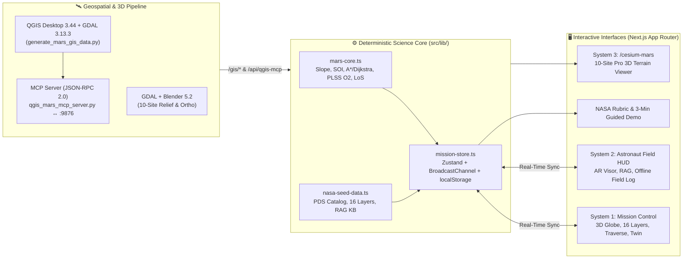

<div align="center">

# 🚀 MARS PATHFINDER
### *Intelligent Planetary Exploration & Human Mission Planning System*

**EXPLORE WITH PURPOSE. DISCOVER BEYOND THE KNOWN.**  
*From Orbital Data to Human Discovery — NASA Space Apps Challenge 2026*

[](https://nextjs.org/)
[](https://www.typescriptlang.org/)
[](https://threejs.org/)
[](https://qgis.org/)
[](https://modelcontextprotocol.io/)
[](https://pds.nasa.gov/)

</div>

---

## 🧭 Overview

**MARS PATHFINDER** is a full-stack aerospace and planetary GIS platform built for the **NASA Space Apps Challenge 2026**. It bridges fragmented orbital datasets (MRO HiRISE, CRISM, MOLA, Mars Odyssey THEMIS, Viking) and rover telemetry (Perseverance, Curiosity, InSight) with **real-time human EVA safety engineering**—unifying a **Mission Control** workspace, a first-person **Astronaut Field HUD**, a **10-Site 3D Mars Viewer** (`/cesium-mars`), and a live **QGIS Desktop + GDAL + MCP** geospatial pipeline.

Every scientific layer and measurement enforces **strict NASA Provenance** (`mission`, `instrument`, `product_id`, `observation_date`, `spatial_resolution`, `coverage`, `uncertainty`, and `temporal_class`) and explicitly penalizes low-resolution orbital zones (`463 m/px` MOLA) when compared against high-resolution `0.25 m/px`–`1 m/px` HiRISE DEMs.

---

## 🏗️ System Architecture



---

## ✨ Core Systems & Features

### 1. Mission Control Workspace (10 Modules)
* **Planetary Intelligence Map & 3D Mars Globe** ([MarsGoogleEarthViewer.tsx](file:///src/components/globe/MarsGoogleEarthViewer.tsx)): Interactive Three.js Mars globe + 2.5D/3D terrain extrusion for **Jezero Crater** and **Gale Crater (Mount Sharp)** with coordinate/slope inspection, radio blackout zones, radiation shelters, and multi-route overlays.
* **16-Layer Cartographic Manager** ([LayerManagerSidebar.tsx](file:///src/components/mission-control/LayerManagerSidebar.tsx)): 7 scientific layers (HiRISE/CTX Optical, HiRISE/MOLA DEM, CRISM Mineralogy, THEMIS Thermal Inertia, USGS Geology, RIMFAX/DAN Subsurface, PIXL/SuperCam/ChemCam/APXS Chemistry) + 9 environmental/EVA safety layers (MEDA/REMS Atmosphere, Curiosity RAD Radiation, NASA DONKI Space Weather, Slope, Roughness/Slip, Boulders, Data Uncertainty, Radio Line-of-Sight & Shelters, Human Traverse).
* **Scientific Opportunity Index ($SOI$) Engine**: Interactive normalized weighting sliders ($\alpha + \beta + \gamma + \delta = 1$):
  $$SOI = \alpha M + \beta G + \gamma T + \delta Q$$
* **Smart Traverse Planner ($A^*$ vs. Dijkstra)**: Computes and benchmarks 3 comparative routes side-by-side with interactive elevation, slope, and $\text{O}_2$ discharge profiles (Recharts):
  * **Route A (Shortest Distance):** Minimizes distance ($D$), often traversing steep slopes ($18^\circ\text{--}19^\circ$) and triggering *Bingo* $\text{O}_2$ alerts.
  * **Route B (Max Human Safety & Min $\text{O}_2$):** Penalizes slope, roughness, slip hazard, and orbital uncertainty ($U$).
  * **Route C (Max Scientific Value):** Visits high-$SOI$ waypoints while respecting suit slope limits ($S_{\max}$) and $\text{O}_2$ budget.
* **EVA Life Support & *Bingo* $\text{O}_2$ Engine** ([mars-core.ts](file:///src/lib/mars-core.ts)): Models human locomotion under Martian gravity ($g_{\text{Mars}} = 3.721\text{ m/s}^2$), suit/PLSS mass, sample load ($5\text{--}40\text{ kg}$), terrain sinkage factor ($\eta$), metabolic rate ($M_E$ in Watts), volumetric $\text{O}_2$ consumption ($\dot{V}_{\text{O}_2}$), and mandatory **20% return reserve** (*Bingo* $\text{O}_2$).
* **Pre-EVA Dust Storm & Space Weather Predictor**: Combines $\Delta P$ (3h barometric drop), dust optical depth ($\tau$), solar longitude ($L_s$), surface-air thermal gradient ($\Delta T$), and wind gusts into a `GO / CAUTION / NO-GO` operational classifier.
* **Mission Twin, 10-Step Mission Planner, KPI Dashboard & Robotic Support Planner**: Live `1x / 5x / 10x` excursion playback, Scout Rover / Aerial Drone rendezvous planning, and real-time KPI synchronization.

### 2. Astronaut Field HUD (9 Modules)
* **First-Person AR Helmet Visor** ([AstronautHudWorkspace.tsx](file:///src/components/astronaut-hud/AstronautHudWorkspace.tsx)): Curved FUI visor synchronized in real time across tabs/windows via `Zustand` + `BroadcastChannel` + `localStorage`.
* **Navigation & Target Recognition**: $0^\circ\text{--}360^\circ$ compass ribbon, 3D/AR waypoint guidance, and clickable AR reticles for **Cheyava Falls** (`JZ-TARGET-001`), **Marginal Carbonate Unit** (`JZ-TARGET-002`), and **Mount Sharp Boxwork Formations (2025)** (`GALE-TARGET-001`).
* **Terrain Awareness & Emergency Simulator**: Live inclinometer, geomechanical slip/puncture warnings, low-resolution DEM uncertainty alerts, and one-click emergency simulation (Solar Particle Event / Dust Gust / Low $\text{O}_2$) routing to the nearest topographic radiation shelter.
* **Offline-First Scientific Field Log (`COMM_BLACKOUT`)**: Raycasted Radio Line-of-Sight (LoS) automatically switches logging to `OFFLINE_LOCAL_CACHE` inside deep canyons/craters and syncs queued samples to Mission Control upon signal recovery.
* **Verifiable 3-Block Field RAG Assistant**: Every response is strictly structured into `[1] NASA Measured Data (PDS IDs)`, `[2] Derived Products & Models`, and `[3] Scientific Interpretation & Limitations`.
* **Squad Tactical Minimap**: Real-time tracking of `EVA-1 (Commander)`, `EVA-2 (Geologist)`, and `Rover Scout`.

### 3. 10-Site 3D Mars Viewer (`/cesium-mars`)
* Dedicated route ([src/app/cesium-mars/page.tsx](file:///src/app/cesium-mars/page.tsx) & [MarsCesiumProViewer.tsx](file:///src/app/cesium-mars/MarsCesiumProViewer.tsx)) showcasing **10 iconic Martian landing & exploration sites** (Jezero Crater, Gale/Mount Sharp, Olympus Mons, Valles Marineris, Hellas Planitia, InSight Elysium, Mars Pathfinder Ares Vallis, Spirit Gusev, Opportunity Meridiani, Viking 1) processed via [generate_10_sites_gdal_blender.py](file:///src/app/cesium-mars/generate_10_sites_gdal_blender.py).

### 4. QGIS Desktop, GDAL Pipeline & MCP Bridge
* **Geospatial Pipeline** ([qgis/generate_mars_gis_data.py](file:///qgis/generate_mars_gis_data.py)): Runs on PyQGIS 3.44.15 + GDAL 3.13.3 + NumPy to generate Mars Equidistant Cylindrical (`+R=3396190m`) DEMs, slope, roughness, hillshade, viewshed LoS, contours, GeoJSONs, `public/gis/qgis_processed_terrain.json`, and [mars_pathfinder_master.qgs](file:///qgis/mars_pathfinder_master.qgs).
* **QGIS Desktop MCP Plugin & Server** ([qgis/mars_pathfinder_mcp_plugin/](file:///qgis/mars_pathfinder_mcp_plugin/plugin.py) & [mcp/qgis_mars_mcp_server.py](file:///mcp/qgis_mars_mcp_server.py)): Bridges AI assistants and the Next.js `/api/qgis-mcp` endpoint to live QGIS Desktop (`127.0.0.1:9876`), `qgis_process`, and GDAL CLI.

---

## 🛰️ Featured NASA Target Regions & PDS Provenance

| Target ID | Region & Site | Coordinates & Elevation | Key Instruments & PDS Context |
| :--- | :--- | :--- | :--- |
| `JZ-TARGET-001` | **Jezero Crater** — *Cheyava Falls (Bright Angel)* | `18.56° N, 77.40° E` · `-2,540 m` | MRO HiRISE (`ESP_065842_1985`, `0.25 m/px`), CRISM (`FRT000047A3`), Perseverance SHERLOC, PIXL (`SOL_1215_CHEYAVA_FALLS`), Mastcam-Z |
| `JZ-TARGET-002` | **Jezero Crater** — *Marginal Carbonate Unit* | `18.52° N, 77.38° E` · `-2,490 m` | MRO CRISM (`HRL000040FF`), HiRISE DEM (`DTEEC_045994_1985`, `1.0 m/px`), Perseverance RIMFAX, SuperCam |
| `GALE-TARGET-001` | **Gale Crater / Mount Sharp** — *Boxwork Formations (2025)* | `4.68° S, 137.42° E` · `-3,820 m` | MSL Curiosity Mastcam & ChemCam (`MSL_2025_MOUNT_SHARP_BOXWORK`), APXS, MRO HiRISE (`PSP_009149_1750`), CRISM (`FRT0000B6F1`) |

---

## 🚀 Getting Started

### Prerequisites
* **Node.js** `>= 18.18` & **npm**
* *(Optional, for regenerating GIS rasters/3D assets)* **OSGeo4W / QGIS LTR 3.44+** with GDAL 3.13+ and **Blender 5.2+**

### Installation & Local Development

```bash
# 1. Clone the repository
git clone https://github.com/eduardoevz/mars-pathfinder.git
cd mars-pathfinder

# 2. Install dependencies
npm install

# 3. Start the Next.js development server
npm run dev
```

Open [http://localhost:3000](http://localhost:3000) for **Mission Control & Astronaut Field HUD**, and [http://localhost:3000/cesium-mars](http://localhost:3000/cesium-mars) for the **10-Site 3D Mars Viewer**.

### Optional: Regenerate QGIS / GDAL Geospatial Data

```bash
npm run qgis:pipeline
```

---

## 📁 Repository Structure

```text
mars-pathfinder/
├── src/
│   ├── app/
│   │   ├── api/                    # Next.js API routes (mars-tiles, qgis-mcp)
│   │   ├── cesium-mars/            # 10-site 3D Mars viewer + GDAL/Blender pipeline
│   │   ├── layout.tsx & page.tsx   # Root aerospace shell & telemetry hydration
│   ├── components/
│   │   ├── mission-control/        # System 1: 10-module Mission Control workspace
│   │   ├── astronaut-hud/          # System 2: 9-module AR Astronaut Field HUD
│   │   ├── globe/                  # Interactive Three.js 3D Mars Globe
│   │   └── rubric-modal/           # NASA Space Apps 2026 Rubric & 3-Min Guided Demo
│   └── lib/
│       ├── mars-core.ts            # Slope, SOI, A*/Dijkstra, PLSS O2, LoS & Dust models
│       ├── mission-store.ts        # Zustand + BroadcastChannel + localStorage sync
│       └── nasa-seed-data.ts       # PDS metadata, 16 layers & verifiable RAG KB
├── qgis/
│   ├── generate_mars_gis_data.py   # PyQGIS + GDAL terrain & texture pipeline
│   ├── mars_pathfinder_master.qgs  # Master QGIS Desktop project
│   ├── mars_pathfinder_mcp_plugin/ # Live QGIS Desktop socket plugin (:9876)
│   └── data/                       # GeoTIFF DEMs, slopes, hillshades, roughness, viewsheds
├── mcp/
│   └── qgis_mars_mcp_server.py     # JSON-RPC 2.0 MCP server bridging QGIS & GDAL
├── public/gis/                     # Web-ready GeoJSONs, terrain JSON, textures & WMTS cache
├── documentacion/                  # NASA Space Apps 2026 guides, pitch & technical docs
├── brag-output/                    # Hyperframes launch video composition & media assets
└── package.json
```

---

## 🎥 Media & Documentation

* **3D Mission Demo:** [mars_mission_3d.mp4](file:///mars_mission_3d.mp4)
* **30s Launch Stop-Motion:** [mars_pathfinder_stopmotion_30s.mp4](file:///mars_pathfinder_stopmotion_30s.mp4)
* **Technical & Economic Viability:** [PROYECCION_VIABILIDAD_TECNICA_Y_ECONOMICA.pdf](file:///PROYECCION_VIABILIDAD_TECNICA_Y_ECONOMICA.pdf)
* **Documentation & Pitch Scripts:** [documentacion/](file:///documentacion/)

---

<div align="center">
  Built for <strong>NASA Space Apps Challenge 2026</strong> · Eduardo Velasquez
</div>
